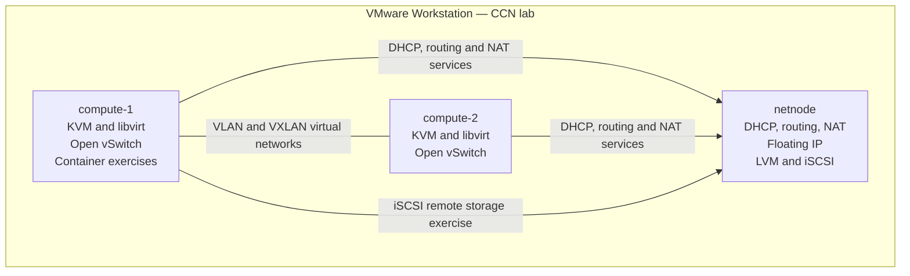

# Cloud Computing and Networking — Hands-on Laboratory

**University of Rome Tor Vergata · Cloud Computing and Networking (CCN)**


A collection of laboratory scripts, configurations, and small applications used to explore **how cloud infrastructure works beneath the orchestration layer**. The work covers virtual machines, Linux networking, distributed virtual networks, DHCP and routing, remote block storage, Docker, and Kubernetes.

> **Scope:** This is an educational, multi-node lab that implements and simulates cloud-infrastructure building blocks. It is **not** a complete production OpenStack deployment or a one-command installer.

## Contents

- [Lab architecture](#lab-architecture)
- [Technologies and learning goals](#technologies-and-learning-goals)
- [Repository structure](#repository-structure)
- [Compute-1](#compute-1)
- [Compute-2](#compute-2)
- [Netnode](#netnode)
- [Docker and Kubernetes exercises](#docker-and-kubernetes-exercises)
- [How to explore this repository](#how-to-explore-this-repository)
- [Backup and restoration](#backup-and-restoration)
- [Documentation status](#documentation-status)

## Lab architecture

Three Ubuntu virtual machines were used as the main laboratory nodes in VMware Workstation.



**How to read the diagram:**

- **compute-1 and compute-2** represent separate compute hosts. KVM/libvirt runs guest VMs inside these Ubuntu machines; Open vSwitch is used for virtual networking.
- **VLAN and VXLAN** are studied to connect isolated virtual networks across compute hosts, with forwarding behavior controlled by OpenFlow rules.
- **netnode** provides networking functions such as DHCP, virtual-router/NAT operations, and floating IPs. It also serves as a remote-storage node in the iSCSI/LVM exercises.
- **Docker and Kubernetes** exercises are included in the repository as application and container orchestration work.

The diagram is a **logical overview**, not a wiring diagram of every interface or proof that every possible service was running simultaneously.

### VMware host networks

The original VMware Virtual Network Editor showed these networks:

| Network | Type | Subnet | DHCP |
| --- | --- | --- | --- |
| `VMnet1` | Host-only | `192.168.56.0/24` | Enabled |
| `VMnet8` | NAT | `192.168.96.0/24` | Enabled |

These are *VMware host-level* networks, distinct from the tenant-like virtual networks configured inside the Ubuntu machines. The exact network adapter mapping for each VM should be recorded separately when reproducing the lab.

## Technologies and learning goals

| Area | Technologies | Laboratory goals |
| --- | --- | --- |
| Virtualization | KVM, QEMU, libvirt, `virt-install` | Define VMs, attach disks and network interfaces, manage guest instances |
| Virtual switching | Linux bridge, Open vSwitch, OpenFlow | Connect virtual interfaces and program forwarding behavior |
| Network virtualization | VLAN, VXLAN | Extend logically separate virtual networks across hosts |
| Network services | Linux network namespaces, DHCP, routing, SNAT/DNAT | Provide address allocation, gateways and floating IP connectivity |
| Storage | LVM, iSCSI | Compare local/ephemeral disks with network-attached persistent block storage |
| Containers | Docker, Dockerfiles, Python | Package microservices and experiment with container networking |
| Orchestration | Kubernetes, YAML manifests | Explore pods, services, deployments and inter-service communication |
| Automation | Bash, XML, YAML | Configure and document lab components as reusable files |

## Repository structure

```text
ccn-cloud-computing-networking/
├── README.md
├── compute-1/
│   ├── virtualization/
│   ├── networking/
│   └── storage/
├── compute-2/
│   ├── virtualization/
│   ├── networking/
│   └── README.md
├── netnode/
│   ├── virtualization/
│   ├── networking/
│   │   └── dhcp/
│   ├── storage/
│   └── README.md
└── microservices/
    ├── sum/
    ├── sum.kubernetes/
    ├── chain/
    │   ├── add1/
    │   └── add2/
    ├── pingcontainers/
    └── name/
```

*This tree summarizes the files identified and organized during the backup process; additional files may exist in the repository.*

## Compute-1

**Path:** [`compute-1/`](compute-1/)

The first compute node was used for KVM/libvirt, virtual switching, the VXLAN lab, iSCSI access, and container-oriented exercises.

| File | Role in the lab |
| --- | --- |
| `virtualization/vminstall-kvm.sh` | Helper script for VM creation through KVM/libvirt tooling |
| `virtualization/vminstall-ovs.sh` | Helper script for VM creation with Open vSwitch-related networking |
| `virtualization/tc3-red.xml` | VM definition associated with the guest named `tc3-red` |
| `virtualization/br-int-net.xml` | Libvirt network definition associated with the integration bridge |
| `networking/br-tun-reload-compute-1.sh` | Reapplies or configures tunnel-side Open vSwitch/OpenFlow settings on compute-1 |
| `storage/compute1-iscsi.sh` | Compute-side script associated with connecting to remote iSCSI storage |

**Key idea:** A compute node runs guests locally while participating in a virtual network that can span multiple hosts.

## Compute-2

**Path:** [`compute-2/`](compute-2/)

The second compute node is the counterpart to compute-1 in the distributed virtualization and virtual networking exercises.

| File | Role in the lab |
| --- | --- |
| `virtualization/vminstall-kvm.sh` | KVM/libvirt VM creation helper |
| `virtualization/vminstall-ovs.sh` | VM creation helper for Open vSwitch networking |
| `virtualization/tc2-red.xml` | VM definition associated with `tc2-red` |
| `virtualization/vnet1.xml` | Libvirt virtual network definition |
| `virtualization/br-int-net.xml` | Integration-bridge-related network definition |
| `networking/br-tun-reload-compute-2.sh` | Tunnel bridge and distributed network configuration helper |

**Key idea:** Virtual networking connects guests across compute hosts without treating each host's local bridge as an isolated network.

## Netnode

**Path:** [`netnode/`](netnode/) · [Detailed netnode notes](netnode/README.md)

Netnode combines **network services** with the **remote storage** functionality used in the labs.

### Networking and DHCP

| File | Role in the lab |
| --- | --- |
| `networking/add-floating.sh` | Adds a floating-IP-related address and NAT rules for a private VM |
| `networking/br-tun-reload-netnode.sh` | Configures or reloads tunnel-side Open vSwitch networking on netnode |
| `networking/neotronsim-reload.sh` | Reloads parts of the simulated Neutron-style networking setup |
| `networking/neotronsimr.sh` | Supporting script for the simulated routing/network-service environment |
| `networking/dhcp/vnet1-dhcp.conf` | DHCP configuration for virtual network 1 |
| `networking/dhcp/vnet2-dhcp.conf` | DHCP configuration for virtual network 2 |

The DHCP files preserve the lab's network-specific settings. Consult the files themselves for the **exact address pools, interfaces and DHCP options**.

### Remote storage

| File | Role in the lab |
| --- | --- |
| `storage/netnode-iscsi.sh` | Storage-side configuration associated with iSCSI and the LVM-backed storage lab |

The storage exercise explores allocating a logical volume on a storage node and exporting block storage to a compute-side initiator through iSCSI. **Do not run storage setup scripts on a different machine without checking device names; commands may change or overwrite disks.**

### Additional virtualization definitions

| File | Role in the lab |
| --- | --- |
| `virtualization/vminstall-kvm.sh` | KVM/libvirt VM creation helper |
| `virtualization/vminstall-ovs.sh` | VM creation helper for Open vSwitch connectivity |
| `virtualization/tc2-red.xml` | Preserved libvirt guest definition |
| `virtualization/vnet1.xml` | Preserved libvirt virtual network definition |
| `virtualization/br-int-net.xml` | Integration-bridge-related libvirt network definition |

## Docker and Kubernetes exercises

**Path:** [`microservices/`](microservices/)

| Directory | Contents and intended learning goal |
| --- | --- |
| [`sum/`](microservices/sum/) | Python `sum.py` and `Dockerfile` — packaging a simple application as a Docker image |
| [`sum.kubernetes/`](microservices/sum.kubernetes/) | `sum.py`, `Dockerfile`, `sum.yaml` — container image and Kubernetes-related manifest |
| [`chain/add1/`](microservices/chain/add1/) | Python `add1.py` and `Dockerfile` — one component of a service chain |
| [`chain/add2/`](microservices/chain/add2/) | Python `add2.py` and `Dockerfile` — another component of the chain |
| [`pingcontainers/`](microservices/pingcontainers/) | `Dockerfile` associated with container networking/connectivity experiments |
| [`name/`](microservices/name/) | Preserved Python `name.py` application |

These exercises connect cloud networking concepts to **containerized microservices**. The course also covers pods, deployments, services, ingress, and composing multi-service applications; not every topic necessarily has a separate implementation in this repository.

## How to explore this repository

Clone it to a Linux machine with Git installed:

```bash
git clone https://github.com/AliRezalatifi1993/ccn-cloud-computing-networking.git
cd ccn-cloud-computing-networking
```

Start by reading the node directories and the source/configuration files. **Do not run the networking or storage scripts without reviewing them:** many depend on the original lab's interfaces, networks, namespaces, and virtual disks.

To contribute an update to your own working copy:

```bash
git pull --ff-only origin main
# Edit files and review your changes
git status
git add README.md
git diff --cached
git commit -m "Improve CCN lab documentation"
git push origin main
```

If multiple machines edit the same repository, pull the latest changes before starting new work and resolve any conflicting changes before pushing.

## Backup and restoration

The **complete VMware VM folders** (`compute-1`, `compute-2`, and `netnode`) are backed up separately in private OneDrive storage. Their virtual disks are **not** stored in this Git repository.

For full restoration, retrieve the entire original VM folders, including the `.vmx` configuration and all linked `.vmdk` disk files. Restore the correct VMware virtual networks, verify network adapter assignments, and enable nested virtualization if required by the KVM exercises.

The GitHub repository preserves selected **code, scripts, and configuration files**; it is not a replacement for the full VM backup.

## Documentation status

- The three node directories and the microservice projects were identified during the CCN backup process.
- **File purposes are high-level descriptions** based on names and course activities; exact script behavior should be verified against the source code.
- DHCP settings, interface names, OpenFlow rules, and iSCSI device paths should be documented in more detail after inspecting the scripts.
- Potential future improvements: verified execution steps, topology screenshots, test results, detailed per-script commentary, and a CI workflow for a Python service.

> **Security note:** Do not commit passwords, private SSH keys, GitHub tokens, iSCSI credentials, or other secrets. Review configuration files before making a repository public.

---

*Educational laboratory work from the Cloud Computing and Networking course at the University of Rome Tor Vergata. Full VM backups are stored privately; this repository documents the corresponding hands-on configurations and application exercises.*
